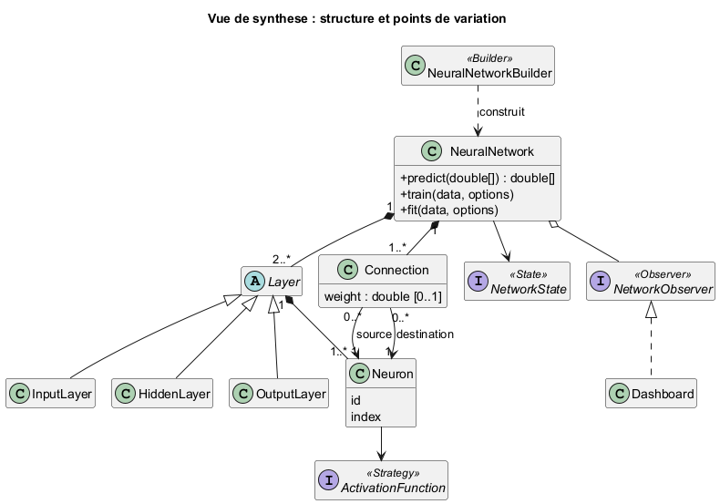
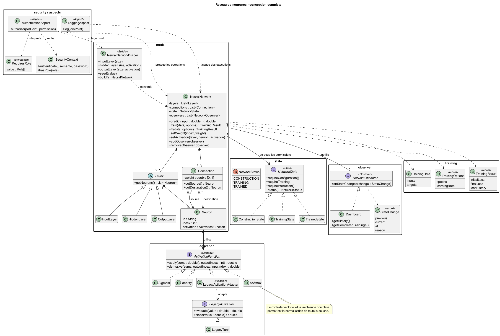
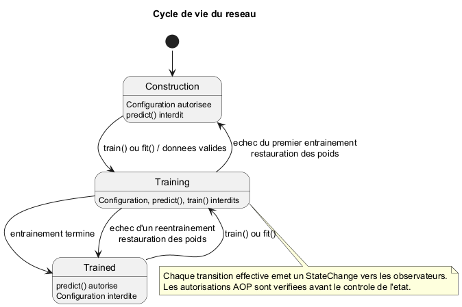
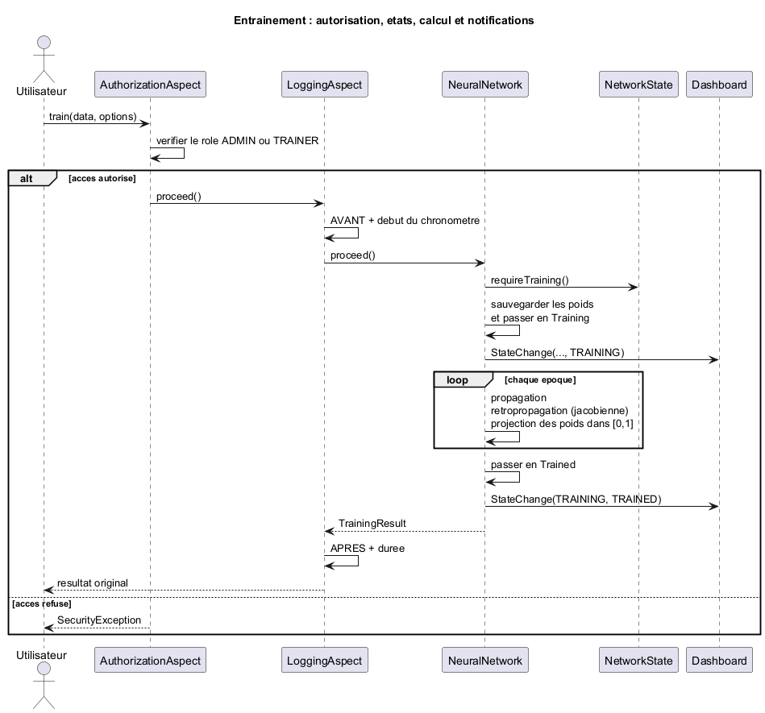

# Réseau de neurones et Design Patterns

## Présentation

Ce projet implémente un réseau de neurones multicouche en Java, avec propagation avant, apprentissage par rétropropagation et prédiction. Sa conception combine plusieurs **design patterns** pour séparer le calcul, la construction, le cycle de vie et les notifications.

La démonstration repose sur une architecture **3 entrées → 5 neurones cachés → 2 sorties**. Les aspects prennent en charge les autorisations et la journalisation, indépendamment du calcul neuronal.

## Technologies

- **Java** : modèle objet, calculs et structures de données.
- **Spring Boot** : configuration et intégration de la démonstration.
- **AspectJ** : contrôle des rôles et journalisation des méthodes.
- **Maven** : dépendances, compilation et tests.
- **JUnit et Spring Boot Test** : vérification du calcul et du comportement.

## Concepts et patterns appliqués

| Concept | Rôle dans le projet |
|---|---|
| **Builder** | Construire les couches et connexions, valider la topologie et initialiser les poids de façon reproductible. |
| **Strategy** | Rendre interchangeables les fonctions d’activation : identité, sigmoïde et softmax. |
| **Adapter** | Intégrer une ancienne fonction d’activation sans modifier son interface. |
| **State** | Encadrer les opérations selon les états de construction, d’entraînement et d’entraînement terminé. |
| **Observer** | Notifier les changements d’état et alimenter l’historique ainsi que les statistiques du tableau de suivi. |
| **AOP** | Appliquer les autorisations et mesurer les exécutions sans mélanger ces responsabilités au calcul. |

## Réalisation

1. **Structuration du modèle** : couches, neurones, connexions et données d’apprentissage validées.
2. **Fonctions d’activation** : stratégies interchangeables et adaptation d’une implémentation existante.
3. **Cycle de vie** : états contrôlant la configuration, l’entraînement et la prédiction, avec notification des observateurs.
4. **Calcul neuronal** : construction du réseau, propagation avant, rétropropagation et mise à jour des poids.
5. **Aspects transversaux** : authentification de démonstration, contrôle des rôles et journalisation des méthodes.
6. **Vérification** : tests des activations, gradients, transitions, notifications et restrictions d’accès.

## Diagrammes

### Vue d’ensemble

Structure du réseau et points d’extension associés aux patterns.

### Diagramme de classes

Relations entre le modèle neuronal, les activations, les états, les observateurs et les aspects.

### Diagramme d’états

Transitions entre construction, entraînement et réseau entraîné, avec les opérations autorisées à chaque étape.

### Diagramme de séquence

Déroulement d’un entraînement : autorisation, journalisation, calcul, changement d’état et notifications.

## Résultat

Le projet réunit un apprentissage neuronal fonctionnel et une conception extensible. Les responsabilités sont séparées, le cycle de vie est contrôlé et les comportements de calcul, de notification et de sécurité sont couverts par des tests automatisés.
